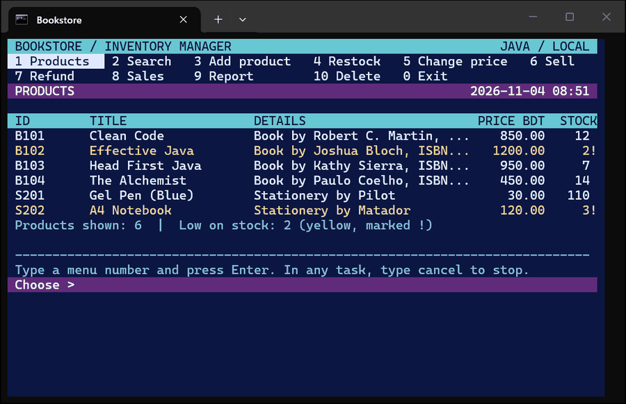
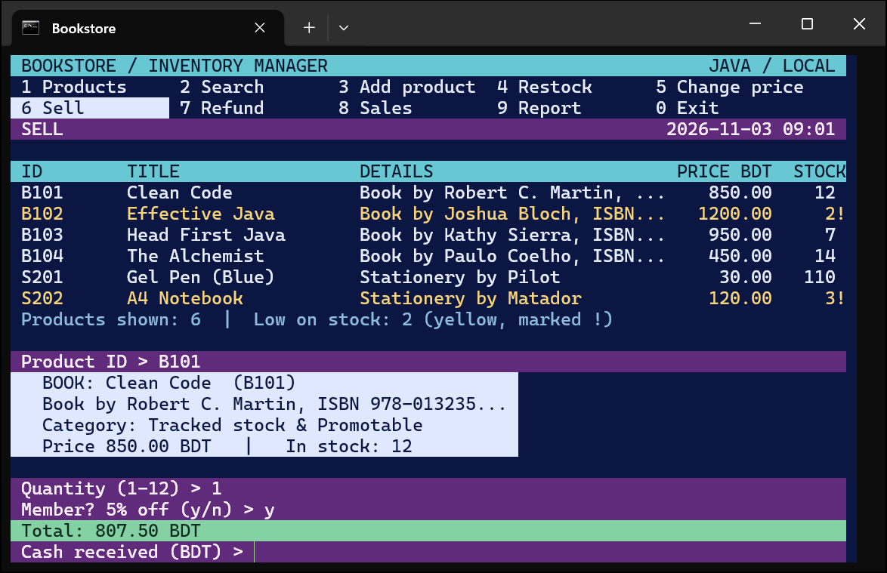
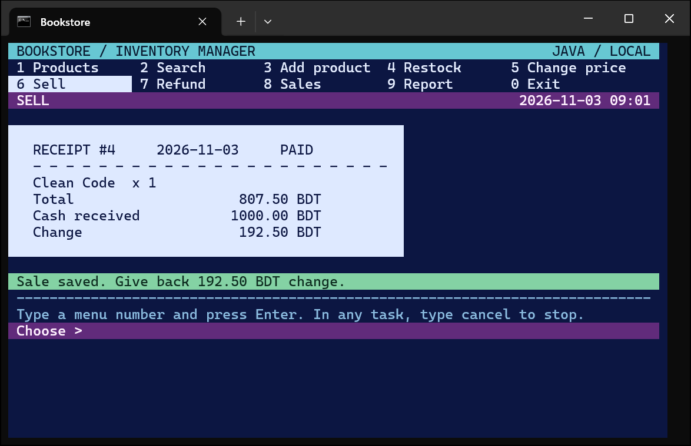
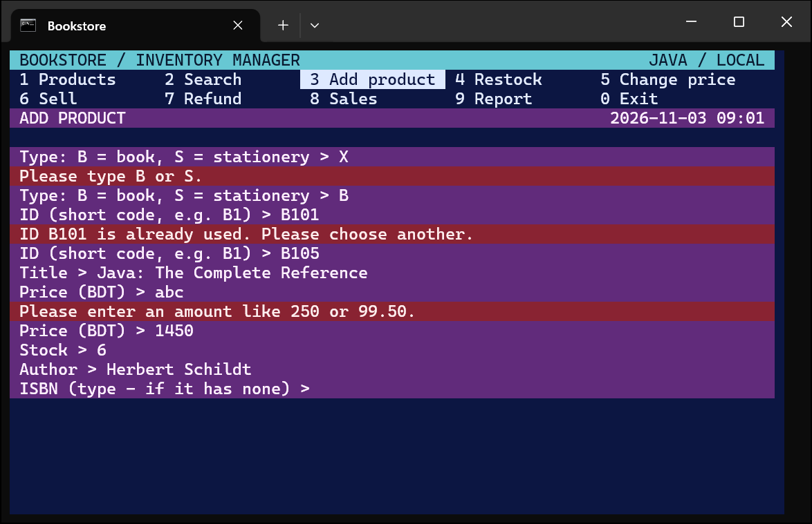
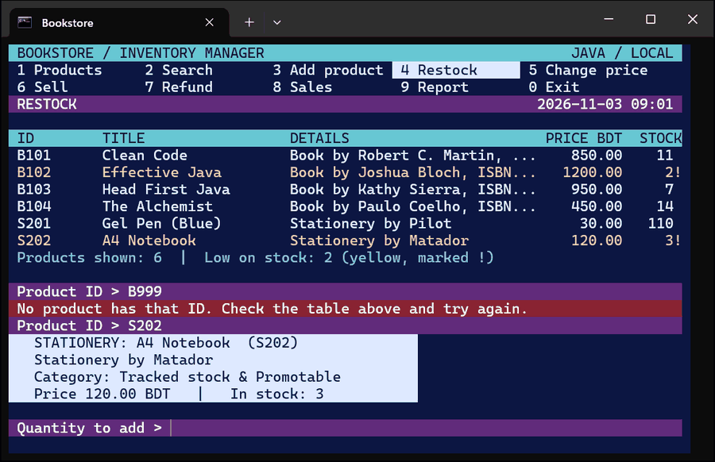
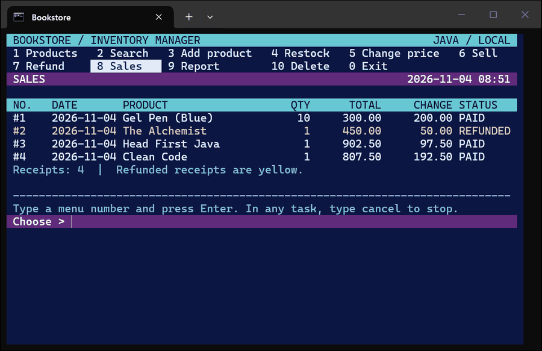
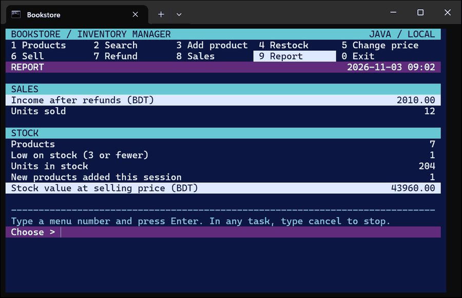

# Bookstore-JAVA

A Java console application for a small bookstore, with a colorful full-screen terminal interface. The code is short (4 files) and uses simple syntax, and it demonstrates every core **Object-Oriented Programming (OOP)** concept from the course inside real features.

**Project report (PDF, 13 pages):** [docs/Bookstore-Project-Report.pdf](docs/Bookstore-Project-Report.pdf) — why this project, features, how it works (with diagrams), screenshots of every screen, all 11 OOP concepts with their code, limitations and conclusion.

**Presentation (Google Slides, 21 slides):** [View the presentation](https://docs.google.com/presentation/d/1if5fkjqZGf6V8-vpenAkUtjIuvOIZxUUxsQWVOg3HL8/edit?usp=sharing) — why this project, the features on real screens, how it works, all 11 OOP concepts in the code, tools and next steps.



---

## Table of Contents
1. [Features](#features)
2. [How to Compile and Run](#how-to-compile-and-run)
3. [Project File Structure](#project-file-structure)
4. [OOP Concepts in the Code](#oop-concepts-in-the-code)
5. [Screenshots](#screenshots)
6. [Data Storage](#data-storage)
7. [Testing](#testing)

---

## Features

| Key | Screen | What it does |
| :---: | :--- | :--- |
| `1` | Products | Table of all products; low stock (3 or fewer) is yellow and marked `!` |
| `2` | Search | Find products by ID, title, author, brand or ISBN |
| `3` | Add product | Add a book (ISBN, or `-` if it has none) or a stationery item |
| `4` | Restock | Add received units to a product |
| `5` | Change price | Set a new unit price (old receipts keep their price) |
| `6` | Sell | Quantity, optional 5% member discount, cash and change, then a receipt |
| `7` | Refund | Refund a whole receipt once; the stock goes back |
| `8` | Sales | History of all receipts; refunded ones are yellow |
| `9` | Report | Income after refunds, units sold, low stock, products added this session, stock value |
| `0` | Exit | Close the program (everything is already saved) |

If an answer is wrong (unknown ID, too little cash, a letter instead of a number…), the program says why in red and asks that question again. Type `cancel` at any question to stop the current task without changing anything.

---

## How to Compile and Run

**Requirement:** JDK 17 or newer on your PATH.

**Easiest:** double-click `run.bat` (or type `.\run` in a terminal in this folder). It compiles the program and opens it in its own window that is exactly the program's size (80 × 24). Choosing `0 Exit` closes the window.

**By hand** (in a terminal at least 80 characters wide):

```powershell
javac *.java
java Main
```

---

## Project File Structure

```
Bookstore-JAVA/
├── Product.java      126 lines  Item, Trackable, Promotable (interfaces), abstract Product, Book, Stationery
├── Bookstore.java    139 lines  shop rules (add, restock, sell, refund, search), saving and loading; class Sale
├── BookstoreUI.java  222 lines  everything on screen: colors, menu tabs, tables, receipt, questions
├── Main.java         148 lines  start-up, menu loop, one method per task
├── run.bat            10 lines  compiles and opens the program in an 80 × 24 window
└── docs/                        project report (PDF) and screenshots
```

**Size:** 635 lines of Java in total — 491 lines of code, 71 one-line comments (plus 35 short comments at the end of a line) and 73 blank lines.

**How the files work together:** `BookstoreUI` shows a screen and reads the answer → `Main` decides which task runs → `Bookstore` checks the rules, changes the data and saves it → `Product` / `Sale` are the data → `BookstoreUI` shows the result.

---

## OOP Concepts in the Code

Every concept is used by a real feature. The [report](docs/Bookstore-Project-Report.pdf) shows the code for each one.

| # | Concept | Where | In this program |
| :---: | :--- | :--- | :--- |
| 1 | **Abstraction** | `Product.java` | `abstract class Product` with abstract `getType()` and `getDetails()`; interfaces `Item`, `Trackable`, `Promotable` |
| 2 | **Encapsulation** | `Product.java` | `private` id, title, price, stock; getters; setters refuse negative values |
| 3 | **Inheritance** | `Product.java` | `class Book extends Product`, `class Stationery extends Product` (subclasses of the superclass) |
| 4 | **Polymorphism** | `BookstoreUI.showProducts` | `p.getDetails()` runs `Book`'s or `Stationery`'s version for each product (runtime); overloading (compile time) |
| 5 | **Static vs non-static** | `Product.java` | `static final CURRENCY` set in a `static { }` block; `static createdCount` + `Product.getCreatedCount()` shown in the Report |
| 6 | **Method overloading** | `Product.java`, `Bookstore.java` | Two `Book(...)` constructors (with / without ISBN); `restock(String, int)` and `restock(Product, int)` |
| 7 | **Method overriding** | `Product.java` | `@Override getType()` / `getDetails()` in Book and Stationery; `getCategory()` in Product |
| 8 | **`this` keyword** | `Product.java` | `this.id = id;` and constructor chaining `this(id, title, price, stock, author, "N/A")` |
| 9 | **`super` keyword** | `Product.java` | `super(id, title, price, stock)` in subclass constructors; `Trackable.super.getCategory()` |
| 10 | **Subclass vs superclass reference** | `Main.addProduct` | `Book book = new Book(...)` → `book.getAuthor()`; then `Product product = book;` (upcasting) |
| 11 | **Diamond problem** | `Product.java` | `Trackable` and `Promotable` both extend `Item` with their own `default getCategory()`; `Product` implements both and resolves it with `Trackable.super.getCategory() + " & " + Promotable.super.getCategory()` |

---

## Screenshots

| Sell (member discount) | Receipt |
| :---: | :---: |
|  |  |
| **Add product — wrong answers are asked again** | **Restock — wrong ID, then the product card** |
|  |  |
| **Sales history (refunded in yellow)** | **Report** |
|  |  |

---

## Data Storage

Every change is saved straight away to `bookstore.dat` using Java object serialization: `ObjectOutputStream` writes the whole `Bookstore` object (all products and sales) in one step, and `ObjectInputStream` reads it back at start-up. If the file does not exist, the store starts empty; if it is damaged, the program says so and does not overwrite it. `bookstore.dat` and `.class` files are not uploaded (see `.gitignore`).

---

## Testing

- **30 automated test cases** (add, validation, search, restock, price, sell, cancel, refund, report, menu, storage) — **30 passed**.
- **50 random-input sessions** (random menu choices and answers) — **0 crashes, 0 broken data files**.
- Real-window testing in an 80 × 24 Windows Terminal; every screenshot comes from these runs.
